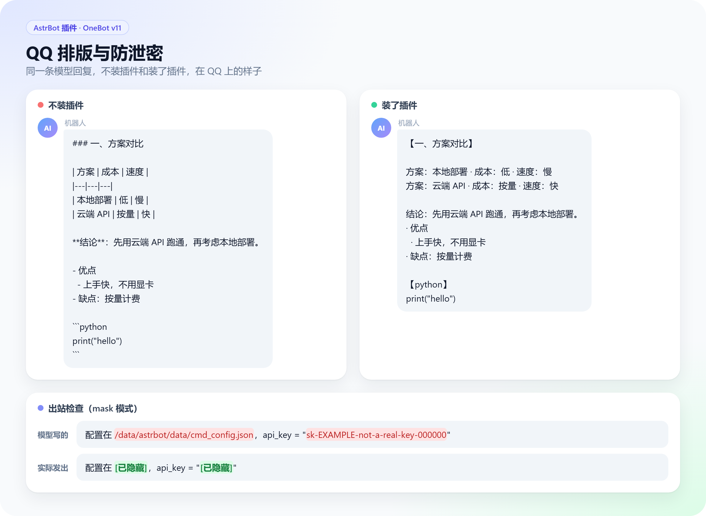

[English](README.md) · **简体中文**

# QQ 排版与防泄密


**把模型回复里的 Markdown 转成 QQ 里好读的纯文本，并在发出前检查有没有带出服务器路径、内部地址和密钥。**

经 OneBot（NapCat、LLOneBot、Lagrange 等）接入的 QQ 不渲染 Markdown，模型却仍会写 `**`、`#` 标题、表格和代码围栏，到了手机上就是满屏符号。这个 AstrBot 插件在消息发出前把它们转成纯文本，同时检查所有将要发往 QQ 的内容：既包括自己的回复，也包括其他插件直接调用 OneBot 接口发出的消息。

插件不注册 LLM 工具，也不需要发指令，装上即可生效；所有设置都在插件配置里。

[效果](#效果) · [为什么用它](#为什么用这个插件) · [快速开始](#快速开始) · [出站检查](#出站检查) · [配置](#配置) · [使用边界](#使用边界) · [更新日志](CHANGELOG.md)

> **出站检查默认为 `log` 模式**：命中只写进日志，不改动任何消息。建议先观察一段时间的命中情况，再决定是否切换到 `mask` 或 `drop`，见[快速开始](#快速开始)。

---

## 效果



QQ 上原样显示的：

<!-- readme-example:input -->
````markdown
### 一、方案对比

| 方案 | 成本 | 速度 |
|---|---|---|
| 本地部署 | 低 | 慢 |
| 云端 API | 按量 | 快 |

**结论**：先用云端 API 跑通，再考虑本地部署。

- 优点
  - 上手快，不用显卡
- 缺点：按量计费

```python
print("hello")
```
````

群里收到的：

<!-- readme-example:output -->
```text
【一、方案对比】

方案：本地部署 · 成本：低 · 速度：慢
方案：云端 API · 成本：按量 · 速度：快

结论：先用云端 API 跑通，再考虑本地部署。
· 优点
  · 上手快，不用显卡
· 缺点：按量计费

【python】
print("hello")
```

---

## 为什么用这个插件

- **每条回复都好读** — 标题变成 `【】`，列表项前加 `·`，表格逐行转成「键：值」，代码块加上语言标签，代码本身保持原样。转换在模型生成之后进行，不依赖模型是否遵守提示词。
- **不改其他插件的排版** — 默认只处理模型回复，运势、签到、日报等插件自行排好的内容原样发出。不含 Markdown 的文字不做任何改动；转换出错时发送原文。
- **发出前的最后一道检查** — 每条回复在回复流程的最后接受检查；OneBot 发送接口上另有一道闸门，其他插件直接发送的内容也在检查范围内，包括定时消息、合并转发、上传文件的文件名和流式分段。
- **自动保护 AstrBot 配置里的密钥** — 配置中已有的 API 密钥、令牌和密码无需重复填写。自己的主机名、路径和容器名按原文填写即可，支持 `*` 通配，无需正则。
- **先观察，再拦截** — 默认只记日志。`/防泄密` 可以查看每条规则的命中次数，也能测试一段文字且不复述原文，方便在启用打码或拦截前排查误判。日志里不会出现完整的密钥，只记录打码样本（前 4 个字符）、长度和字段名。

### 方案对比

| | 模型原样输出 | 在人设里要求「不要用 Markdown」 | **本插件** |
|---|---|---|---|
| **标题、列表、粗体** | `#`、`-`、`**` 直接显示为符号 | 取决于模型每次是否遵守 | **每条回复都在模型生成后统一转换** |
| **表格** | 满屏竖线和横线 | 取决于模型是否主动改写 | **每行转成一条「键：值」** |
| **代码** | 连同围栏一起发出 | 取决于模型 | **加语言标签，代码保持原样** |
| **回复中的敏感信息**（服务器路径、内部地址、密钥） | 原样发出 | 原样发出 | **记日志、打码或拦下** |
| **其他插件直接发送的敏感信息** | 原样发出 | 原样发出 | **在 OneBot 发送接口上检查** |

---

## 功能

| 能力 | 说明 |
|---|---|
| **排版** | 把标题、多层列表、任务列表、表格、代码块、链接、引用和常见 HTML 标签转成纯文本；只处理 `Plain` 段。见[排版](#排版)。 |
| **回复检查** | 在回复流程的最后执行，检查 `platforms` 名单上的每条回复，不限于模型回复。 |
| **发送层闸门** | 装在每个 `aiocqhttp` 客户端的 `api.call_action` 上，检查消息、合并转发、上传文件、群公告和 AI 语音中的文字。见[直接发送](#直接发送)。 |
| **内置规则** | 私钥、服务令牌（`sk-`、GitHub、AWS、腾讯云、阿里云等）、机器人令牌、JWT、`key = value` 赋值、带密码的网址、服务器路径和内部地址。见[规则](#规则)。 |
| **配置里的密钥** | 读取 AstrBot 主配置和 `data/config/` 下的所有配置文件，保护字段名看起来像密钥的值，每 5 分钟重新读取一次。 |
| **自定义名单** | `internal_hosts`、`private_paths`、`internal_names` 和 `known_secrets`，均按原文匹配。 |
| **模式** | `log`（默认）、`mask`、`drop` 或 `off`，两处检查共用。 |
| **管理员指令** | `/防泄密`（`/outbound_guard`）：查看状态、按规则统计命中、测试文字（不复述原文）、清零统计。见[管理员指令](#管理员指令)。 |

---

## 快速开始

需要 AstrBot 4.28.1 及以上（4.x），QQ 通过 `aiocqhttp`（OneBot v11）适配器接入。

| 方式 | 操作 |
|---|---|
| **1. 从仓库安装（推荐）** | 在 AstrBot 面板中通过仓库地址 `https://github.com/MystryMocha/astrbot_plugin_qq_pretty` 安装插件 |
| **2. 上传 zip** | 将本仓库下载为 zip，在 AstrBot 面板中上传 |

插件目录名必须是 `astrbot_plugin_qq_pretty`，以上两种方式都会使用这个名字。插件依靠它定位自己的数据目录，并识别由自己发起的调用。

安装后，按三步确认：

1. **确认排版**：向机器人提一个模型会用列表或表格回答的问题，群里收到的应当是纯文本，无需任何配置。
2. **确认检查**：以 AstrBot 管理员身份发送 `/防泄密`（或 `/outbound_guard`），回复中会显示当前模式、发送层闸门装在几个 OneBot 连接上，以及保护了几个配置密钥。
3. **观察后再选模式**：先在 `log` 模式下运行一段时间，用 `/防泄密` 查看哪些规则在命中，对照日志排查误判，再把 `outbound_check.mode` 改为 `mask` 或 `drop`。

---

## 排版

只处理 `Plain` 段，图片等其他组件原样通过。不含 Markdown 的文字不做改动；转换出错时发送原文。默认只处理模型回复（`llm_only`），其他插件自行排好的内容不受影响。流式回复不排版，见[使用边界](#使用边界)。

| Markdown | 转换为 |
|---|---|
| `# 标题`（1–6 级） | `【标题】`；`heading_style: plain` 时只保留文字 |
| `- 项`、`* 项`、`+ 项` | `· 项`，每深一层多缩进两格 |
| `- [x] 完成`、`- [ ] 待办` | `✓ 完成`、`□ 待办` |
| 带表头的两列表格 | 每行一条「键：值」 |
| 带表头的多列表格 | 每行一条「表头：值 · 表头：值」 |
| 以 `---` 行开头、没有表头的表格 | 单元格之间用 ` · ` 连接 |
| 代码块 | 首行为 `【python】`，其后是代码（未标语言时为 `【代码】`），见 `code_block_style` |
| 行内 `` `code` `` | 去掉反引号（开启 `keep_inline_code` 时保留） |
| `**粗体**`、`*斜体*`、`~~删除线~~` | 去掉标记 |
| `[文字](网址)`、`` | `文字 网址`、`说明 网址`（文字为空或与网址相同时只保留网址） |
| `> 引用` | `｜引用` |
| `---` 分隔线 | 删除 |
| `<br>` | 换行 |
| `<b>`、`<i>`、`<em>`、`<strong>`、`<p>`、`<div>`、`<span>`、`<h1>`–`<h6>` | 删除 |

有序列表保持不变。代码块和行内代码会先被保护起来，其中的内容不会被改写。连续三个及以上的换行合并为一个空行。输出使用中文聊天常见的全角标点（`：`、`【】`、`｜`）。

---

## 出站检查

回复检查挂在 `on_decorating_result` 的最后（优先级 `-sys.maxsize`），因此检查的是最终文字。检查范围是 `platforms` 名单上所有待发送的回复，不限于模型回复；它与排版共用 `platforms`，但不受 `enabled` 和 `llm_only` 影响。通过其他途径发出的消息由下文的[发送层闸门](#直接发送)负责，两处使用同一套规则、名单和模式。

### 规则

内置规则如下（见 `sensitive.py`），同一条消息中每条规则最多记一次命中：

| 规则 | 匹配内容 |
|---|---|
| `known_secret` | `known_secrets` 中的条目原样出现 |
| `config_secret` | AstrBot 配置文件中的密钥原样出现，见[AstrBot 配置里的密钥](#astrbot-配置里的密钥) |
| `private_key` | PEM 私钥头 |
| `token_prefix` | 长度合理的服务令牌：`sk-`（OpenAI、Anthropic 及各家兼容接口）、`ghp_` 等 GitHub 令牌、`glpat-`、`AKIA`（AWS）、`AKID`（腾讯云）、`LTAI`（阿里云）、`AKLT`（火山引擎）、`AIza`、`ya29.`、`xox?-`、`hf_`、`sk_live_` / `rk_live_`、`xai-`、`gsk_`、`npm_` |
| `bot_token` | Telegram 和 Discord 的机器人令牌 |
| `jwt` | 三段式 `eyJ…` 令牌 |
| `assigned_secret` | `api_key = …`、`"token": "…"` 这类赋值，值至少 16 个字符 |
| `url_credentials` | 带账号密码的网址，如 `redis://用户:密码@主机`、`mysql://…`，任何协议都算 |
| `server_path` | `/AstrBot/data`、`/AstrBot/astrbot`、`/data/{astrbot,napcat,llonebot,lagrange,backups}`、`plugin_data/`、`/root/`、`/home/<用户>/`、`/etc/shadow`、`/etc/sudoers`，以及 `private_paths` |
| `windows_user_path` | Windows 用户主目录路径 |
| `internal_url` | 指向 astrbot、napcat、llonebot、lagrange、localhost、回环地址和内网 IP 的 `http(s)://` 网址，以及 `internal_hosts` |
| `internal_name` | `internal_names` 中的名称作为完整的词出现 |

「token 是多少」「password 忘了」这类日常聊天不算命中；`https://astrbot.app` 这样的公开网址、`./data/…` 这样的相对路径，以及公开网址中的同名路径也不算。规则紧挨着中文时同样能命中，例如「配置在/data/astrbot里」。

### 添加自己的主机、路径和名称

内置规则只覆盖常见的部署方式。你自己的容器名、服务名和目录，请填进下面三个名单。名单按原文匹配、不区分大小写，无需写正则；末尾的 `*` 表示通配。

| 配置项 | 命中条件 | 示例 |
|---|---|---|
| `internal_hosts` | 只在 `http(s)://` 后面作为主机名时命中；正文里单独出现不算 | `my-proxy` 命中 `http://my-proxy:8080`，不命中 `https://my-proxy.example.com` |
| `private_paths` | 以它开头的路径；`/data/my-bot` 不会误中 `/data/my-botx` | `/data/my-bot`、`/opt/stack-*` |
| `internal_names` | 在正文任何位置作为完整的词出现；少于 3 个字符的条目会被忽略 | `mybot-prod-*` 命中 `mybot-prod-astrbot` |

由于 `internal_names` 在正文任何位置都会匹配，请只填写容器名这类有辨识度的名字，不要填常见词。

### AstrBot 配置里的密钥

单靠规则识别不出一串裸的 32 位十六进制密钥，但 AstrBot 自己知道配置过哪些密钥。`protect_config_secrets`（默认开启）会在插件启动时及之后每 5 分钟读取一次主配置 `data/cmd_config.json` 和 `data/config/` 下的所有配置文件（各插件配置和配置文件分组），把字段名看起来像密钥的值当作已知密钥：

- 字段名是 `api_key`、`token`、`secret`、`password`、`access_token`、`jwt_secret`、`ws_reverse_token` 这类，或以 `_token`、`_secret`、`_api_key`、`_password` 等结尾；
- 值至少 8 个字符，由不含空格的可打印 ASCII 字符组成；
- 字段名仅为 `key` / `keys` 时（模型服务的密钥列表用的就是这个名字，但关键词回复类插件也可能用它存触发词），值还须至少 16 个字符，并同时包含字母和数字。

收集到的密钥只保存在内存中。日志只记录数量，命中时记录 `来源文件:字段名(长度)`，从不记录密钥本身。AstrBot 配置之外的密钥，请填入 `known_secrets`。

### 模式

`outbound_check.mode`：

- `log`（默认）：只记日志。
- `mask`：把命中部分替换为 `mask_text`（默认 `[已隐藏]`），其余内容照常发送。赋值只遮住值（`api_key = [已隐藏]`），路径遮住整段，私钥一直遮到结束行，带账号密码的网址只遮住账号和密码。如果一条消息被拆成多段文字，而密钥恰好跨段，就无法逐段打码，这时按 `drop` 处理。
- `drop`：整条消息不发送。设置了 `drop_notice` 时只发送这句提示；未设置时清空消息链，框架不会发送任何内容，也不会触发 `after_message_sent`，群里不会有任何提示。
- `off`：不检查。

填写其他值时按 `log` 处理。

日志格式：`qq-pretty: outbound hit mode= rules= samples= llm= chars=`。样本只保留前 4 个字符和长度；`known_secret` 只记录长度，`config_secret` 记录来源文件、字段名和长度。

### 直接发送

插件可以绕过回复流程直接向 QQ 发送消息，例如定时消息、对群内戳一戳的回应、合并转发和上传文件；框架的流式回复也是逐段直接发送的。`check_direct_sends`（默认开启）会在 OneBot 客户端上加一道闸门，位置是每个 `aiocqhttp` 平台的 `api.call_action`。闸门在插件加载和平台重新加载时安装，在插件卸载时移除；`platforms` 中没有 `aiocqhttp` 时不会安装。

各 OneBot 动作检查的文字如下：

| 动作 | 检查的文字 |
|---|---|
| `send_msg`、`send_group_msg`、`send_private_msg` | 文字段、markdown 段、文件名和消息中的转发节点；CQ 码字符串则检查各段 CQ 码之间的文字 |
| `send_forward_msg`、`send_group_forward_msg`、`send_private_forward_msg` | 每个节点的昵称和内容（包括嵌套转发），以及卡片的 `news`、`prompt`、`summary`、`source` |
| `upload_group_file`、`upload_private_file` | 文件名 |
| `_send_group_notice`、`send_group_ai_record` | 公告正文；待朗读的文字 |

其他动作直接放行。媒体段的 `file`（base64 图片、路径、网址）不会被读取。

各模式在这里同样生效：

- `log`：原样发出。
- `mask`：发送打码后的副本，调用方原有的消息列表不受影响。
- `drop`：不发送。普通消息在设置了 `drop_notice` 时改为向同一会话发送提示；合并转发和文件上传直接拦下，不发提示。

被拦下的调用返回 `None` 而不抛出异常，因为框架记录发送失败的日志会把被拦消息的原文打印出来。检查本身出错时，消息照原样发出，并记录错误日志；协议端的报错（例如被禁言）原样返回给调用方。被拦下的消息在发送方看来已经发出，不会重试，也不会改用其他方式发送。

日志格式：`qq-pretty: send-layer hit action= caller= mode= rules= samples= chars=`。`caller` 是发起调用的插件目录名，框架自己发送回复时为 `astrbot`。在 `log` 模式下，回复检查已经记录过的回复，发出时不会再重复记录。

---

## 管理员指令

`/防泄密`（英文名 `/outbound_guard`）仅限 AstrBot 管理员使用。其他人发送时视为普通聊天，插件不会回应。

| 指令 | 说明 |
|---|---|
| `/防泄密` 或 `/防泄密 状态` | 显示当前模式、发送层闸门装在几个 OneBot 连接上、保护了几个 AstrBot 配置密钥、各名单的条目数（只显示数量，不列出内容），以及命中统计 |
| `/防泄密 测试 <文本>` | 用与实际发送相同的规则、名单和密钥检查这段文字，回复命中了哪些规则，以及当前模式下会如何处理（照发并记日志、打码几处或整条不发）；不会复述原文 |
| `/防泄密 清零` | 从现在起重新统计命中 |

子指令也接受英文 `status`、`test`、`reset`。

**命中统计**：回复检查和发送层闸门的每次实际命中各记一次，同一条回复在两处都被查到时只算一次。统计按来源（回复、直接发送）、处理方式（只记日志、打码、拦下）和规则分别计数，并记录每条规则最近一次命中的时间。统计只保存规则名和数字，存放在 `plugin_data/astrbot_plugin_qq_pretty/hit_stats.json`，在命中后 30 秒内、查看状态时和插件卸载时写入，重载或重启后继续累计。文件损坏时会换一份新文件重新统计。打码样本只在日志里，可按时间在日志中查找 `qq-pretty: outbound hit` 和 `send-layer hit`。`off` 模式不检查也不计数；`测试` 不计入统计。

测试文字和普通消息一样，会被其他插件看到（聊天记录、记忆、群总结），也可能被送给模型。请用格式相同的假值测试，不要粘贴真实密钥，最好在与机器人的私聊中进行。想确认 AstrBot 配置里的密钥是否已收录，查看 `/防泄密` 显示的数量即可，无需拿真实密钥来试。测试只记录一行日志 `qq-pretty: self-test mode= rules= chars=`，不含样本。

---

## 配置

| 配置项 | 默认 | 说明 |
|---|---|---|
| `enabled` | 开 | 排版总开关。关闭后按原文发送，`**`、`#` 和表格都会保留 |
| `llm_only` | 开 | 只处理模型回复。关闭后，所有待发送的纯文本都会排版 |
| `platforms` | `aiocqhttp` | 排版和检查共用的平台名单。不要加入 `webchat`，WebUI 本身能渲染 Markdown。留空时使用默认值 |
| `heading_style` | `bracket` | `bracket` 或 `plain` |
| `code_block_style` | `label` | `label`（首行为 `【语言】`，其后是代码，便于复制）、`indent`（每行缩进两格）或 `keep`（保留围栏） |
| `keep_inline_code` | 关 | 保留行内代码的反引号 |
| `outbound_check.mode` | `log` | `off`、`log`、`mask` 或 `drop` |
| `outbound_check.mask_text` | `[已隐藏]` | `mask` 模式下用来替换命中内容的文字 |
| `outbound_check.drop_notice` | 空 | `drop` 拦下回复时改发的提示；留空则不发送任何内容 |
| `outbound_check.check_direct_sends` | 开 | 同时在 OneBot 发送接口上检查，见[直接发送](#直接发送) |
| `outbound_check.protect_config_secrets` | 开 | 把 AstrBot 配置里的密钥当作已知密钥，见[AstrBot 配置里的密钥](#astrbot-配置里的密钥) |
| `outbound_check.known_secrets` | 空 | 配置文件之外、需要原样匹配的字符串；少于 8 个字符的条目会被忽略 |
| `outbound_check.internal_hosts` | 空 | 内部主机名，见[添加自己的主机、路径和名称](#添加自己的主机路径和名称) |
| `outbound_check.private_paths` | 空 | 私有路径前缀，同上 |
| `outbound_check.internal_names` | 空 | 内部名称，同上 |

这些名单只保存在插件配置中，日志里只出现规则名和打码片段。

### 关闭

关闭 `enabled` 即停止排版；把 `outbound_check.mode` 设为 `off` 即停止检查，两者互不影响。关闭 `outbound_check.check_direct_sends` 后只保留回复检查，不再改动 OneBot 客户端。

---

## 使用边界

- **流式回复不排版**：开启流式输出时，框架会跳过结果装饰，流式回复按原文发出（发送层闸门仍会检查）。如需排版，请在框架的「不支持流式回复的平台」设置中关闭流式。
- **只检查文字**：图片、语音和文件内容不在检查范围内，媒体段的 `file` 不会被读取。
- **基于规则，无法保证万无一失**：规则能识别常见格式的路径、地址和密钥，以及 AstrBot 配置和自定义名单中的原值。格式少见的密钥、被模型改写过的密钥，或被拆到两个流式分段、两条消息里的密钥，都可能漏检。
- **调用方察觉不到消息被拦下**：发起调用的插件会以为消息已经发出，不会重试，也不会改用其他方式发送。见[直接发送](#直接发送)。
- **追踪记录中保留未打码的原文（AstrBot 4.29.4 起）**：AstrBot 可以记录追踪（`trace_enable`，默认关闭；默认存放在 `data/logs/traces.db`）。从 4.29.4 起，开启的追踪还会记录 `event.send` 和流式回复的文字（流式只记录前 4 KB 左右）。记录的是插件交出的原始消息，而不是发送层闸门打码后的副本，因此追踪中的这部分内容没有打码。回复流程中的回复在装饰阶段就已经打码。追踪只保存在本机，不会发送到 QQ。
- **仅在 AstrBot 4.28.1 上实际运行过**：4.29.4 和 4.30.0-alpha.1 只做过源码核对，没有实际运行。

---

## 开发

在插件目录下运行测试。`tests/conftest.py` 提供了简易的 AstrBot 替身，无需安装框架即可运行：

```bash
python -m pytest tests -q
```

| 路径 | 内容 |
|---|---|
| `main.py` | 插件入口：读取配置、回复检查、安装发送层闸门、管理员指令 |
| `convert.py` | Markdown 转纯文本 |
| `sensitive.py` | 出站检查规则，以及配置密钥的收集 |
| `gate.py` | 发送层闸门针对每种 OneBot 动作读取和改写哪些文字 |
| `selfcheck.py` | 管理员指令的文案、回复和命中统计 |
| `tests/` | 测试用例，其中一项检查上文[效果](#效果)中的示例与实际转换结果一致 |
| `assets/` | 预览图，以及生成预览图的 `make_preview.py`：图中文字取自上面的示例和插件的实际输出（需要 Pillow 和 Edge 或 Chrome） |

## 反馈与支持

欢迎在 Issues 中报告问题或提出建议。如果遇到漏检或误判的文字，请用格式相同的虚构值来描述，切勿把真实密钥贴进 Issue。

如果这个插件让你的群聊更清爽，欢迎在 GitHub 上点一颗 **Star**，让更多 AstrBot 用户发现它。

版本历史见 [CHANGELOG.md](CHANGELOG.md)（英文）。

## 许可

[MIT](LICENSE)。出站检查的规则改编自 [qq-bridge](https://github.com/Derpyu520/qq-bridge)（MIT，提交 `a49877f`），其版权与许可声明附在 [LICENSE](LICENSE) 末尾和 `sensitive.py` 文件开头。

QQ 是腾讯公司的商标。本项目与腾讯及 AstrBot 项目均无隶属关系。
